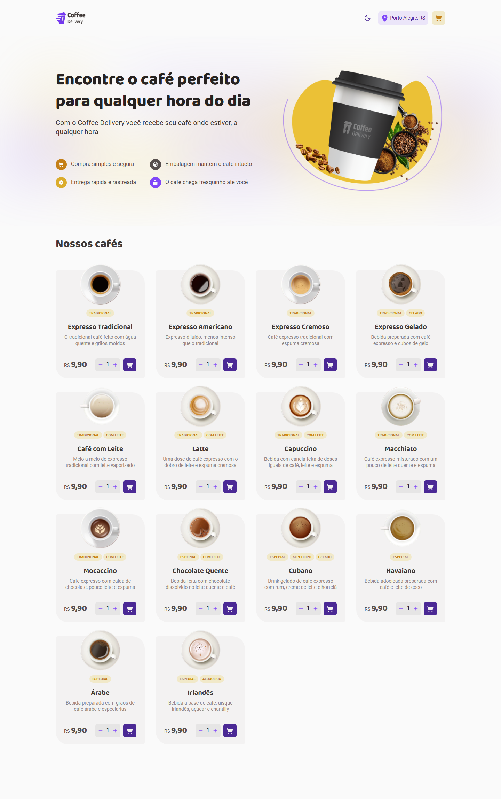

# Coffee Delivery

SPA de uma cafeteria fictícia, desenvolvida para o projeto final de Single Page Application. É possível escolher entre 14 cafés, editar o carrinho, informar a entrega e confirmar um pedido simulado. A interface tem temas claro e escuro e se adapta a desktop, tablet e celular.



## Executar localmente

Use Node.js 22.12+ na série 22 e npm. O repositório traz `.nvmrc` e `package-lock.json`.

```bash
npm ci
npm run dev
```

Abra a URL que o Vite imprimir no terminal. Para gerar o build e conferir o resultado localmente, execute `npm run build` e `npm run preview`.

## Tecnologias

React 19, Vite **8.3.8**, TypeScript, Tailwind CSS 4, React Router, React Hook Form, Zod, Context API com `useReducer` e LocalStorage. A interface usa Baloo 2, Roboto e ícones Phosphor.

## Testes e evidências

```bash
npm test
npx playwright install chromium
npm run test:e2e
npm run build
```

A verificação cobre oito testes unitários e sete cenários no navegador, incluindo carrinho em duas abas, armazenamento indisponível, edição do CEP e navegação por teclado. As capturas abaixo foram feitas com o build local e dados fictícios.

| Tela | Captura |
| --- | --- |
| Checkout antes do preenchimento | [Checkout](docs/evidencias/checkout.png) |
| Endereço e pagamento escolhidos | [Checkout preenchido](docs/evidencias/checkout-preenchido.png) |
| Pedido confirmado | [Confirmação](docs/evidencias/confirmacao.png) |
| Início e checkout em celular no modo escuro | [Início móvel](docs/evidencias/catalogo-mobile-dark.png) · [Checkout móvel](docs/evidencias/checkout-mobile-dark.png) |

## Publicar na Vercel

Importe o repositório na Vercel e selecione **Vite** com **Node.js 22.x**. O arquivo `vercel.json` define `npm run build`, a saída `dist` e o fallback para o React Router. O projeto usa dados locais e dispensa variáveis de ambiente. [Documentação da Vercel para Vite](https://vercel.com/docs/frameworks/frontend/vite)

## Especificações e uso de IA

- [PRD_SPEC.md](PRD_SPEC.md) descreve requisitos, regras de negócio e critérios de aceite.
- [TECH_SPEC.md](TECH_SPEC.md) documenta arquitetura, componentes, estado e testes.
- [TASKS_SPEC.md](TASKS_SPEC.md) acompanha as etapas da implementação e da entrega.
- [AGENTS.md](AGENTS.md) reúne as diretrizes para assistentes e o registro de como o Codex, o MCP do Figma e o ImageGen apoiaram o projeto.

As fotos dos cafés, ilustrações e ícones foram exportados da cópia do protótipo acadêmico. A marca do cabeçalho e do favicon usa um símbolo original gerado com ImageGen. [Projeto no Figma](https://www.figma.com/design/Q8fX8D6T32ZbVAIPqU9kIF/?node-id=0-1) · [Style Guide](https://www.figma.com/design/Q8fX8D6T32ZbVAIPqU9kIF/?node-id=2-1297)
