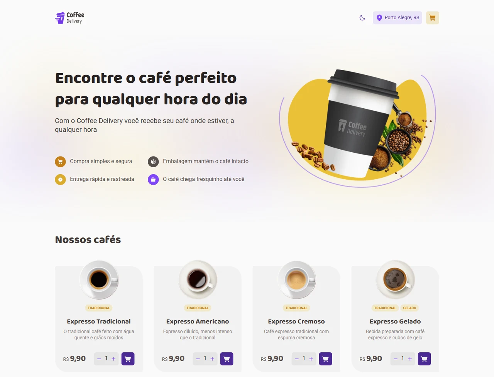
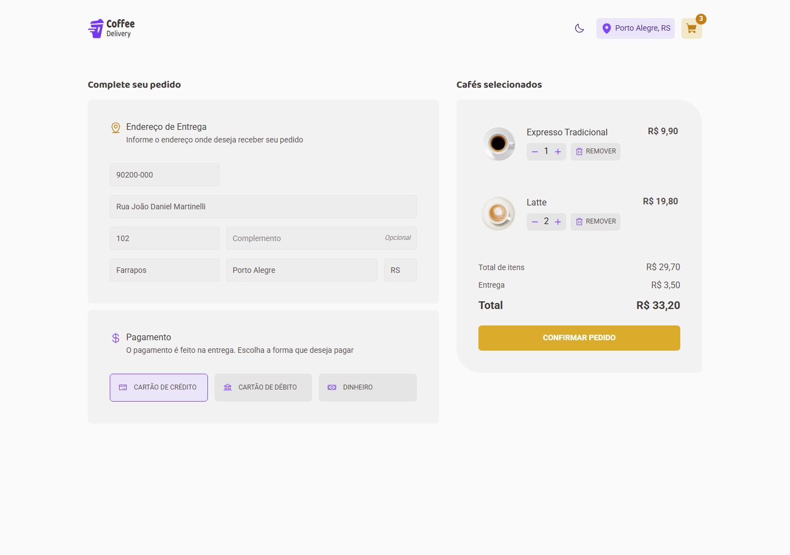
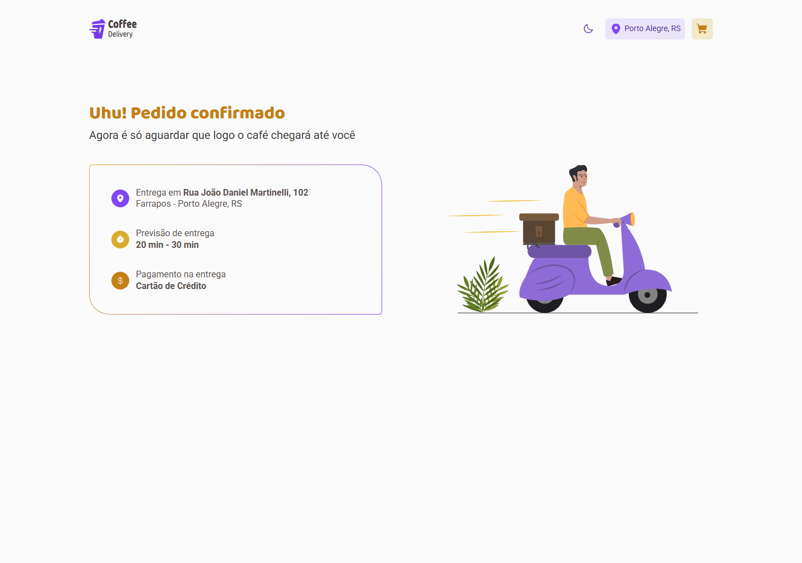
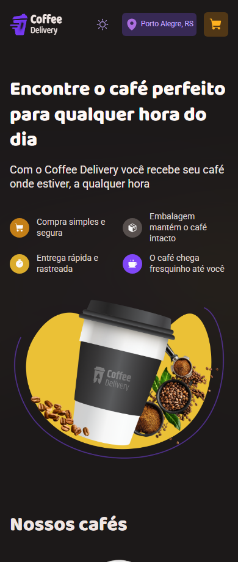
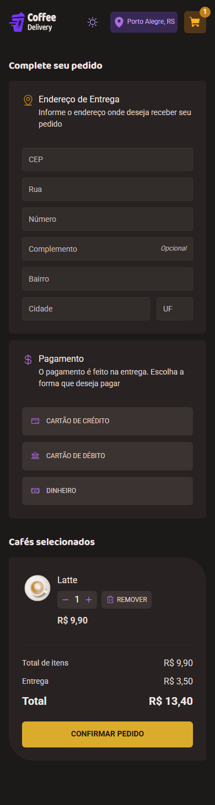

<h1 align="center">
  <picture>
    <source media="(prefers-reduced-motion: reduce)" srcset="./docs/readme/hero-estatico.svg">
    
  </picture>
</h1>

<p align="center">
  <strong>Do catálogo à confirmação, um pedido de café em poucos passos.</strong>
</p>

<p align="center">
  Uma cafeteria fictícia com 14 cafés, carrinho persistente e checkout de entrega.<br>
  A interface se adapta a desktop, tablet e celular, com temas claro e escuro.
</p>

<p align="center">
  
  
  
  
  
  
  
</p>

<p align="center">
  <a href="#demonstração">Demonstração</a> ·
  <a href="#executar-localmente">Executar</a> ·
  <a href="#testes">Testes</a> ·
  <a href="#publicar-na-vercel">Vercel</a> ·
  <a href="#documentação-e-créditos">Documentação</a>
</p>

## Demonstração

[](docs/evidencias/catalogo-desktop.png)

[Ver catálogo completo](docs/evidencias/catalogo-desktop.png)

<details>
<summary><strong>Explorar checkout, confirmação e tema escuro</strong></summary>

### Desktop

<p align="center">
  <a href="./docs/evidencias/checkout-preenchido.png"></a>
  <a href="./docs/evidencias/confirmacao.png"></a>
</p>

[Checkout antes do preenchimento](docs/evidencias/checkout.png) · [Checkout preenchido](docs/evidencias/checkout-preenchido.png) · [Confirmação](docs/evidencias/confirmacao.png)

### Celular · tema escuro

<p align="center">
  <a href="./docs/evidencias/catalogo-mobile-dark.png"></a>
  <a href="./docs/evidencias/checkout-mobile-dark.png"></a>
</p>

</details>

## Fluxo de compra

<picture>
  <source media="(prefers-reduced-motion: reduce)" srcset="./docs/readme/fluxo-estatico.svg">
  
</picture>

| Etapa | O que é possível fazer |
| --- | --- |
| **Catálogo** | Comparar os 14 cafés, escolher quantidades e adicionar itens. |
| **Carrinho** | Editar ou remover itens. O carrinho permanece após recarregar a página. |
| **Checkout** | Informar o endereço e escolher crédito, débito ou dinheiro para pagamento na entrega. |
| **Confirmação** | Consultar o endereço, a forma de pagamento e a previsão da entrega simulada. |

O carrinho usa Context API, `useReducer` e LocalStorage. O checkout valida os dados com React Hook Form e Zod. A interface usa Baloo 2, Roboto e ícones Phosphor.

## Executar localmente

Use **Node.js 22.12+ na série 22** e npm. O projeto inclui `.nvmrc` e `package-lock.json`.

```bash
npm ci
npm run dev
```

Abra a URL que o Vite imprimir no terminal. Os comandos abaixo geram e servem o build de produção localmente.

```bash
npm run build
npm run preview
```

## Testes

A suíte cobre **8 testes unitários** e **7 cenários no Chromium**, incluindo carrinho em duas abas, armazenamento indisponível, edição de CEP e navegação por teclado.

```bash
npm test
npx playwright install chromium
npm run test:e2e
```

As capturas da galeria usam o build local e dados fictícios.

## Publicar na Vercel

Importe o repositório na Vercel e configure **Vite** e **Node.js 22.x**. O [`vercel.json`](vercel.json) define o comando `npm run build`, a saída `dist` e o fallback para as rotas do React Router. O projeto usa dados locais e dispensa variáveis de ambiente. [Guia da Vercel para Vite](https://vercel.com/docs/frameworks/frontend/vite)

## Documentação e créditos

| Documento | Conteúdo |
| --- | --- |
| [PRD_SPEC.md](PRD_SPEC.md) | Requisitos, regras de negócio e critérios de aceite. |
| [TECH_SPEC.md](TECH_SPEC.md) | Arquitetura, componentes, estado e estratégia de testes. |
| [TASKS_SPEC.md](TASKS_SPEC.md) | Planejamento e acompanhamento da implementação. |
| [AGENTS.md](AGENTS.md) | Diretrizes e registro do uso de Codex, MCP do Figma e ImageGen. |

As fotos de cafés, ilustrações e ícones vieram do protótipo acadêmico. O símbolo da marca, usado na capa, no cabeçalho e no favicon, foi gerado com ImageGen. [Projeto no Figma](https://www.figma.com/design/Q8fX8D6T32ZbVAIPqU9kIF/?node-id=0-1) · [Style Guide](https://www.figma.com/design/Q8fX8D6T32ZbVAIPqU9kIF/?node-id=2-1297)
